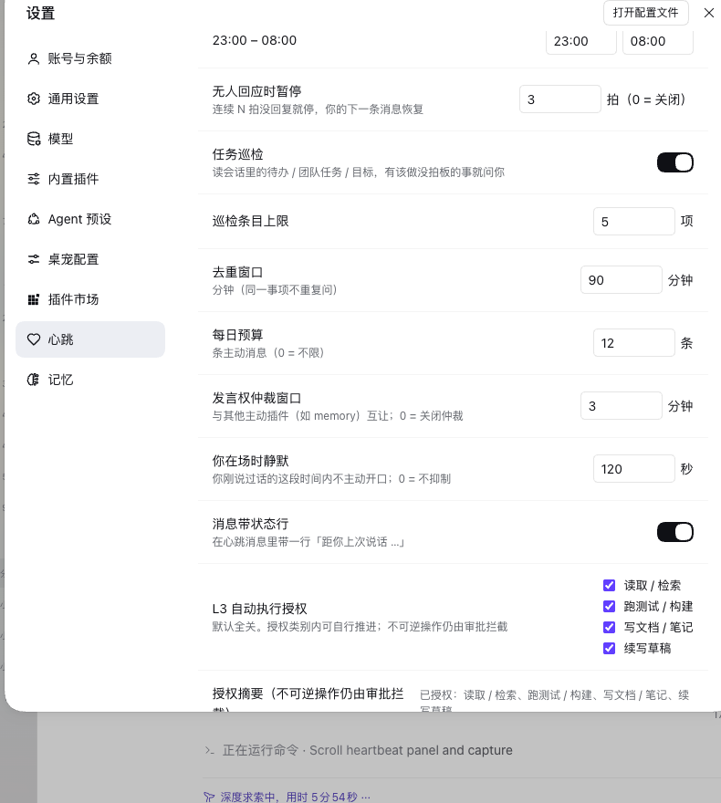
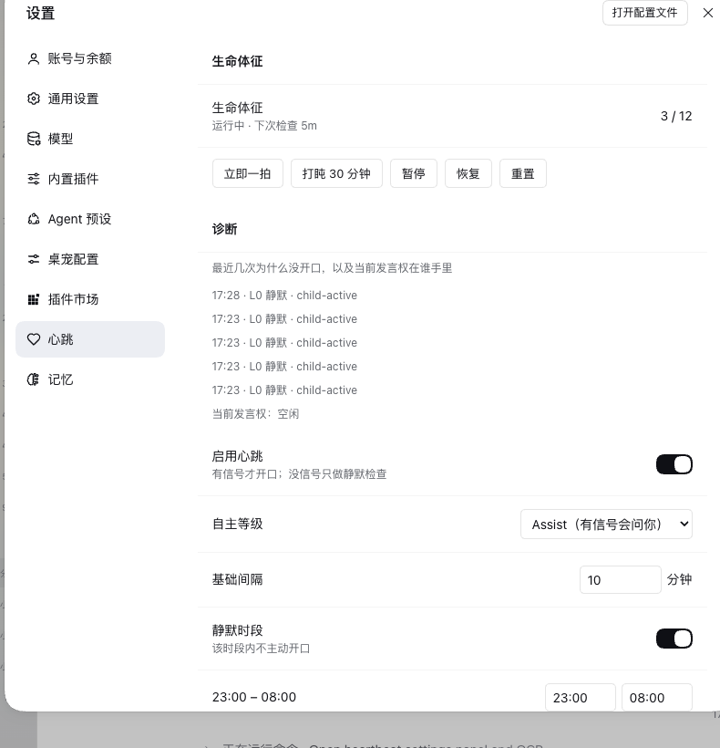

# dsh-plugin-heartbeat

**中文** ｜ [English](README.md)

<p align="center">
  <a href="https://github.com/LittleBlackTong/dsh-plugin-heartbeat"></a>
  <a href="https://github.com/LittleBlackTong/dsh-plugin-heartbeat/actions/workflows/ci.yml"></a>
  <a href="https://www.npmjs.com/package/dsh-plugin-heartbeat"></a>
  
  
</p>

> DeepSeek Harness 的「自主神经」心跳：平时静默拍脉搏、读会话投影，**只在真有变化时开口**——L1 汇报、L2 问你要不要做、L4 升级提醒。没信号就不发消息。

**English TL;DR** — An autonomic heartbeat for [DeepSeek Harness](https://github.com/deepseek-ai/deepseek-harness): it pulses silently, diffs the session's projections, and only opens a turn on a real change (L1 report / L2 ask / L4 escalate); no signal, no message.

v0.5 把心跳变成「懂任务」；**v0.6.0 把它从节拍器升级成自主神经**：每拍静默读一次会话、算出 arousal（唤醒度），有理由才开口；没东西可说时只记一条 vitals 脉搏、不注入任何消息。

## 注意：v0.6.0 默认行为变了

- **0.5.x**：每个 `intervalSeconds` 都注入一条消息，不管有没有事（任务快照被反复复述）。
- **0.6.0**：默认是**静默拍**——没信号就不开轮、不注入。只有检测到「值得说」的变化时才按 L1/L2/L4 开口（见下面的等级表）。
- 配置文件升级为 **v2**：`intervalSeconds` → `baseIntervalSeconds`，另加节律 / 静默时段 / 去重 / 预算 / L3 / 工作区字段。旧的 v1 `heartbeat.json` 在加载时**自动迁移**，不需要你动手。
- 运行态单独存 `<dshHome>/heartbeat-vitals.json`（与配置分离，手改配置不会污染运行态）。它跨重启保留；重启后的 `restartCooldownSeconds`（默认 5 分钟）内即使有信号也保持安静。
- 设置侧栏的 label 跟随 App 语言——中文显示**「心跳」**、英文显示 **`Heartbeat`**，描边爱心图标不变。

## 怎么工作

Host 平面的 Cordis 插件，给每个 **root agent**（子 agent 跳过）挂一个 runtime —— 包括插件热挂载时已经存在的会话。

每一拍都走同样四步，插件内部**不调用任何 LLM 做判断**：

```
sensors（传感器）→ rhythm（节律）→ gate（门控）→ action（动作）
```

- **传感器**（`lib/sensors.js`）：同步读会话的公开投影 —— `todos`、`agentTeam`、`goal`、`userQuestions`，外加 `contextPressure` —— 并**与上一拍看到的做 diff**。只有变化才会变成信号，每个信号带权重，权重加总成 **arousal（0–8）**。每拍重复同一份待办清单，正是 v0.6 要消除的噪音。
- **节律**（`lib/rhythm.js`）：下一拍间隔 = `baseInterval × (1 + missed) × mood(arousal)`，钳制在 30 秒 – 24 小时；arousal 越高间隔越短（arousal 4 → 间隔缩到三分之一）。静默时段直接不排拍，投递后有 refractory 静默窗，另加一个确定性的小 jitter，避免多个会话在同一刻一起跳。
- **门控**（`lib/gate.js`）：判定 **L0（静默）/ L1（汇报）/ L2（询问）/ L4（升级）**，套用去重窗口与每日预算；你刚说过话、上下文压力过高、处于静默时段、被打盹/暂停时，都拒绝开口。
- **动作**（`lib/runtime.js`）：L1/L2/L4 时先按需压缩长历史，再注入一条消息，内含 **why-now（为什么现在叫你）**、任务快照（`taskNudge` 开着时）与该等级的指令。**L0 拍不注入任何东西**，只在 vitals 历史里记一行。

投递机制（沿用 v0.5）：

- **agent 空闲** → 立刻开新一轮；
- **agent 忙** → 消息停在 `next-turn` inbox，当前轮结束立刻被取走 —— 最多一条待处理，原地替换（`inbox.replace`），绝不堆积；
- 连续没人回 → 达到 `pauseAfterMissed`（默认 3）后**硬停**；只有你的真实消息能复活它并重置相位；
- 可选的滑动**每小时上限**（`maxBeatsPerHour`）防「断续回复不断重置退避」的极端情况。

**事件驱动（v0.6 新增）**：宿主提供 `sessionProjections.onChanged` 时，`todos` / `agentTeam` / `goal` / `userQuestions` 的变化会给会话打标记，**2 秒防抖**后额外跑一拍 —— 仍要过全部门控（去重、预算、静默时段）。没有该服务就退化为纯定时器模式。

## 自主等级（L0–L4）

| 等级 | 行为 | v0.6 默认 |
|---|---|---|
| **L0** | 静默拍：读、diff、记录 —— **不注入** | ✅ 所有无信号 tick 的默认 |
| **L1** | 开一轮，只**汇报**进展 / 风险 / 卡点 | ✅ 仅有进展类信号时 |
| **L2** | 开一轮并**提问**（`ask_user_question`）：要不要现在做 / 怎么选 | ✅ 出现需要决策的信号时 |
| **L3** | 在**已授权类别**内自行推进，不必先问 | ⛔ **默认关闭**（`l3Allow: []`），只做指令级授权 |
| **L4** | 与 L2 相同但要**升级措辞**：同一决策信号已经没人回应（`missed ≥ 2`）—— 只升级措辞，不加频 | ✅ |

需要决策（因而走 L2/L4）的信号：团队任务变**可开始**、团队任务变**被阻塞**、目标进入 **blocked / paused**、有**待回答的用户提问**。只是进展类的信号（团队任务完成、待办变化）走 L1。

### 一段话讲清 L3

L3 是一份**按类别授权的清单** —— `read`（检索 / 读文件）、`test`（跑测试 / lint / 构建）、`notes`（写工作区文档 / 笔记）、`continue`（续写已约定草稿）。默认为空，所以 v0.6 默认行为就是「只问不做」。授权后，L2/L4 消息会多一行，说明这些类别内可以自行推进，其余一切仍然先问。**L3 不是沙箱**：发布、部署、删除、`rm`、git push、任何外部写永远不进白名单，不可逆操作仍由宿主 approval 拦截。授权只改指令，不改宿主的安全检查。

## 信号、去重与预算

| 信号 | 来源（投影 diff） | 去重键 | 权重 |
|---|---|---|---|
| 团队任务变可开始 | `agentTeam` | `team:<id>:ready` | +5 |
| 团队任务变被阻塞 | `agentTeam` | `team:<id>:blocked` | +4 |
| 目标受阻 / 暂停 | `goal` | `goal:<id>:<phase>` | +4 |
| 待回答的用户提问 | `userQuestions` | `question:<callId>` | +3 |
| 待办发生变化（有未完成项） | `todos` | `todos:<signature>` | +2 |
| 团队任务完成 | `agentTeam` | —（只汇报，不去重） | +1 |

`arousal = clamp(Σ 权重, 0, 8)`；arousal 越高，下一拍间隔越短。

开口前会被这些条件抑制（都在 `lib/gate.js`）：

- **你刚说过话**（2 分钟内）—— 让位给人；
- **其他主动插件持有发言权** —— 对方 claim 后的 `proactiveCooldownSeconds`（默认 180 秒）内，本拍记 `L0 · proactive-cooldown` 让位；「立即一拍」是例外；
- **子 agent / teammate 还在跑** —— root 只是在等委派出去的工作，本拍记 `L0 · child-active`、不注入、不压缩（v0.6.1；设 `quietWhileChildrenActive: false` 可恢复旧行为）；
- **上下文压力 > 0.9** —— 接近上下文上限时不额外开轮；
- **静默时段**（默认 `23:00–08:00`，可配置，`null` 关闭）；
- **禁用 / 打盹 / 暂停**，或 `mode: "silent"`；
- **去重**：同一信号键在 `dedupeWindowMinutes`（默认 90）内已经问过 → 丢弃；
- **每日预算**：每个自然日最多 `maxBeatsPerDay`（默认 12，`0` = 不限）条主动消息，进程内跨会话共享计数。

唯一例外是面板上的 **立即一拍（Beat now）**：手动拍跳过「礼貌闸门」（静默时段、预算、去重、你刚说过话、子会话正在跑），但仍会做等级判定，也仍要求 agent 真有可用的驱动面。

## 任务巡检（消息里的快照）

v0.5 起每拍可以携带一段任务快照；传感器复用同一批投影，所以「消息里说的」和「信号判的」不会互相矛盾。

| 投影 | 读到的内容 | 进快照的规则 |
|---|---|---|
| `todos` | 会话待办清单（`content` / `status`） | 只留 `in_progress` / `pending`；`completed` 丢弃 |
| `agentTeam` | Agent Team 团队任务板（`subject` / `status` / `blockedBy`） | 只留未完成条目，按「可开始 → 进行中 → 被阻塞」排序，阻塞会标明依赖 |
| `goal` | 持久目标（`objective` / `phase`） | 只留 `active` / `paused` / `blocked` 三种相位 |

读之前要知道的两件事：

- `agentTeam` 投影**只有启用 Agent Team 可选包时才注册**；未启用时读不到 → 自动降级，不报错、快照里也没有团队任务段。
- `todos` 投影**每个 turn 开始会重置**：心跳看到的是「最近一个 turn 内的待办」，不是会话级长期 TODO。

健壮性：

- 宿主没注册投影服务 / 会话未绑定 / 某个投影读取抛错 → 该信号或该快照降级；**任何读取失败都不会让一拍丢失**；
- 任务块有 **800 字符硬上限**；`taskNudgeMaxItems` 再限每类条目数（默认 5，1–20）；
- 插件对投影**只读不写**，不改你的待办、任务板或目标；
- 自定义 `prompt` 不含 `{{tasks}}` 时，任务块自动追加。

## 生命体征与手动控制

**设置 → Heartbeat** 面板展示心跳自己的生命体征，数据来自 `GET /api/heartbeat/status`（每 10 秒刷新）：

- **状态**：运行中 / 打盹中 / 已暂停（含原因）；
- **下次检查**：按当前节律算出的 ETA；
- **今日预算**：已投递条数 / `maxBeatsPerDay`；
- **最近脉冲**：最近 5 行（时间 + 等级 L0–L4 + 原因）——「它刚才为什么没说话」就查这里。

按钮（POST `/api/heartbeat/control`）：

| 操作 | 效果 |
|---|---|
| **立即一拍（Beat now）** | 立刻强制一拍（手动：跳过礼貌闸门，仍判等级） |
| **打盹 30 分钟（Snooze 30m）** | 30 分钟内不拍（API 的 `minutes` 可配，1–1440） |
| **暂停（Pause）** | 这个会话的心跳停到恢复为止 |
| **恢复（Resume）** | 解除暂停 / 打盹，按当前节律重新排拍 |
| **重置（Reset）** | 清掉打盹与暂停并恢复 |



路由（回环、插件自建）：

| 方法 | 路径 | 用途 |
|---|---|---|
| GET / POST | `/api/heartbeat/config` | 读 v2 配置 / patch 合并（校验后热应用） |
| GET | `/api/heartbeat/status` | 配置摘要、今日预算、每会话生命体征 + `nextBeatAt` + 最近 5 拍 |
| POST | `/api/heartbeat/control` | `{action: "beat-now" \| "snooze" \| "pause" \| "resume" \| "reset", sessionId?, minutes?}` |

指定 `sessionId` 时只作用于该会话，省略则作用于全部存活会话。

面板文案走 DSH 自己的语言层：client 半注入 `locale`、注册 `heartbeat` 命名空间的中英语言包，并在 settings section 上声明 `locale: 'heartbeat'`——所以面板**跟随「设置 → 通用设置 → 语言」**，切换 App 语言即时重渲染（不靠浏览器语言猜）。侧栏 label 走同一套语言包（中文「心跳」/ 英文 `Heartbeat`），语言切换后爱心图标的认领会自动重跑，标记始终落在当前那一行。

### 诊断（v0.8.0）

面板能直接回答「它刚才为什么没开口」，不用翻日志：诊断区列出**最近 5 拍**的时间 / 等级 / **原因**（如 `没有新信号`、`静默时段`、`proactive-cooldown（让位给 memory）`、`child-active`），并显示**当前发言权持有者**（来自 status 路由新增的 `lock` 字段）——一眼就能解释一段安静。L3 区也从只显示勾选框改为同时给出「已授权类别」摘要。




## 与其他插件的发言权仲裁（v0.7.0）

同一段对话里可能有多个主动插件都想说话。v0.7 加了一套极小的共享协议，避免两个插件抢话：

- 投递前先 claim `${DSH_HOME:-~/.dsh}/proactive-cooldown.json` —— `{ version: 1, speaker: "heartbeat" | "memory", at: <epoch ms> }`，tmp+rename 原子写；
- 若记录在 `proactiveCooldownSeconds`（默认 **180**，`0` = 关闭）内且属于**其他 speaker**，本拍让位并记 `L0 · proactive-cooldown（让位给 …）`，之后某一拍再试；
- **立即一拍（Beat now）** 绕过仲裁 —— 手动拍是你的显式请求；
- 模块零 import 自 memory 插件：双方各自独立实现同一协议，任一方可单独安装 / 升级 / 卸载；读不到文件按「无锁」处理，写失败降级为「放行」（是礼貌，不是硬依赖）。

## 生理签名（v0.7.0）

心跳不是 cron：它是有身体的。L1/L2/L4 消息可以在 why-now 之后带一行很短的「状态」，例如 `〔状态：距你上次说话 2h · 今天第 3 次找你〕`：

- 由 `lib/physiology.js` 渲染，硬上限 60 字；`physiologyLine`（默认 `true`）是总开关，自定义 prompt 可以用 `{{physiology}}` 占位符指定位置；
- vitals 新记 `lastUserMessageAt` / `lastTurnEndAt` / `busyMsToday`，所以这行跨重启仍成立；
- 用户 20 分钟内出现过 → 不显示（是观察，不是打扰）；措辞随时段变化（早上好：/ 傍晚了：/ 状态：），深夜更短更轻、不带计数。

`userActiveSuppressSeconds`（默认 **120**，`0` = 不抑制）把「你刚说过话就静默」的窗口做成可配置；它用持久化的 `lastUserMessageAt`，跨重启也生效。

## 子智能体执行中胶囊（v0.7.0）

后台子智能体还在跑时，会话头部可能看起来已经结束。

**这里规避的已知宿主行为**：DSH 会话列表的 `running` 只在 agent 创建 / 销毁时重算，子会话 `api-session/status` 按 session 资源转发——父会话空闲时，它的视图可能拿不到子会话运行状态的变化，于是头部显示「N 个子智能体」而不是「正在运行」，主会话看起来已完成。

现在插件在 `GET /api/heartbeat/status` 的每个会话上报告 `children: { total, running, runningIds }`（来自 `subagentCatalog` / `agentTeam` 的 wire view 加活 agent registry——和 runtime 保持静默用的是同一份宿主真值），客户端在 `conversation.session.header.actions` 注册头部胶囊 **「子智能体执行中 · N」**，每 5 秒轮询；子任务结束自动隐藏，并跟随 App 语言。浏览器标签页隐藏时**暂停轮询**，回到前台立即恢复。**纯插件层，零宿主改动。**


## 安装

```sh
dsh plugin --profile <profile> add dsh-plugin-heartbeat
```

（包内置 `dsh.bundle` manifest，`dsh plugin add` 会把它自动挂进 profile 的 bundles 层；dsh-market 里的一键安装同此通道。）

重启 DSH 后生效。之后在 **设置 → Heartbeat** 面板里随时改模式、间隔、静默时段、去重窗口、预算、L3 授权与任务巡检，保存即热应用（无需重启）。

> ⚠️ **不要**再往 profile 的 `cordis.patch.yml` 里手写 `- insert: {id: dsh-heartbeat, ...}`：
> 那会与 bundle manifest 的自动挂载产生两条同名 entry，整个 profile 会以
> `duplicate loader entry id "dsh-heartbeat"` 启动失败（2026-08-18 实机事故，
> 当时撞的是 memory 插件的同名条目）。运行期配置走 `<dshHome>/heartbeat.json`；
> 覆盖 composition 键（如 `prompt`）用**不带 insert 的 id 覆盖条目**，见下。

## 设置侧栏图标

设置侧栏里的这一项带一个**描边爱心**标记：16×16 网格、`stroke-width: 1.3`（与宿主 `ICON_MEDIUM_STROKE` 一致）、纯黑描边只提供 alpha，可见颜色由 `mask-image` + `currentColor` 决定，深浅主题都跟随。规格与 dsh-plugin-memory 的图标完全统一。官方 `settings.section` 槽只投影 id / order / label，**没有 icon 字段**，所以插件按**当前语言的 label 文本**（中文「心跳」/ 英文 `Heartbeat`）精确认领自己那一行，并用 `MutationObserver` 跟随语言切换（认领键随 label 变化）与面板重挂载重新认领，卸载时清理干净。

## 版本要求

- **DSH：官方 0.2.1-rc.5 系列**。`package.json` 已声明 `engines.dsh: "^0.2.1-rc.5"`——宿主用 semver（`includePrerelease: true`）做引擎闸门，注意 prerelease 语义：`^0.2.1` / `>=0.2.0` **都匹配不上** `0.2.1-rc.5`，必须写 `^0.2.1-rc.5` 才认；它同时覆盖将来 0.2.1 正式版，而 0.3.0-rc.1 会被判不兼容。
- **session format v4**（官方 0.1.7+）。心跳消息的 source 使用 producer-owned kind `plugin:heartbeat`；v4 的原生准入拒绝 v3 的 `{kind:'plugin', plugin:'heartbeat'}` wrapper。v4 与 v3 白名单互斥、无法两全。
- **0.4.2 是最后一个 v3 兼容版本**；**0.5.0 起只支持官方 DSH 0.2.1-rc.5 系列**。0.3.x 暂不支持。
- **请用 0.8.0**：已发布的 0.6.1 误读会话投影——`stateOf()` 返回的是原始 state，普通会话的 `subagent` 身份是 `{}`，被判成「这是子会话」→ **心跳完全挂不上**，child-active 闸门也永不生效；0.6.2 修了这个问题，0.7.0 加了发言权仲裁、生理签名与子智能体胶囊，0.8.0 再加诊断面板、面板内可调仲裁/生理签名配置，以及更省电的胶囊轮询。
- **实机验证**（DSH Desktop 0.2.1-rc.5，重启后加载 v0.6.0 构建）：
  - `GET /api/heartbeat/status` → 200，返回 2 个 live session（含 `sessionId` / `cwd` / `nextBeatAt` / 预算 / history）；`/api/heartbeat/config` 返回 **v2** 配置；
  - 已有的 v1 `heartbeat.json` 自动迁移到 v2（`intervalSeconds` → `baseIntervalSeconds`，新增 mode / 静默时段 / 预算等字段），并自动创建 `heartbeat-vitals.json`；
  - **静默拍生效**：临时把间隔调到 60 秒等一拍，两个会话的 vitals 各记录一条 `L0 · 没有新信号 · delivered: false`，**每日预算仍为 0**（零注入）；随后已恢复 600 秒 / jitter 60；
  - **热插拔**：运行中 `dsh plugin remove` 使 `/status` 从 200 变 401（路由消失、无崩溃），`add` 回来恢复 200 且会话恢复；
  - **控制路由**：未知 action 返回 400，`snooze` 让 `snoozeUntil` 生效，`reset` 清零恢复；
  - 侧栏爱心图标与 `Heartbeat` 区块正常渲染。
  **未单独实机验证**（仅单测覆盖）：事件驱动时延（≤10 秒）、pre-beat 压缩、真实的 L2 提问投递。v0.6 自主层由 186 个单测覆盖。

## 配置（v2）

用户配置在 `<dshHome>/heartbeat.json`（面板可写，也能手改；用 schemastery 校验）。composition 配置是基线层，用户文件覆盖它，匹配到的 `workspaces` 条目再覆盖两者。

| 键 | 默认 | 含义 |
|---|---|---|
| `enabled` | `true` | 总开关 |
| `mode` | `"assist"` | `"assist"` = 有信号就开口；`"silent"` = 永不开口（照常拍脉搏并记录） |
| `baseIntervalSeconds` | `600` | 基础拍间隔（30–86400 秒）；退避档位以它为基准 |
| `pauseAfterMissed` | `3` | 连续 N 拍没人回 → 硬停（`0` = 关闭）；你的下一条消息复活它 |
| `backoffSeconds` | `null` | 显式退避档位数组（`null` = 自动推导 `[base, 2×base, 3×base]`） |
| `compactBeforeBeat` | `true` | 开口前先把长历史压成 checkpoint（尽力而为，失败不影响投递） |
| `maxBeatsPerHour` | `0` | 滑动每小时投递上限（`0` = 关闭） |
| `maxBeatsPerDay` | `12` | 每日投递预算（`0` = 不限），进程内跨会话共享 |
| `dedupeWindowMinutes` | `90` | 同一信号键在该窗口内不重复问（`0` = 关闭） |
| `refractorySeconds` | `300` | 投递后至少安静这么久才允许下一拍 |
| `jitterSeconds` | `60` | 确定性的每会话抖动（0–600 秒），让多个会话错开 |
| `restartCooldownSeconds` | `300` | 重启后即使有信号也先安静这么久 |
| `quietHours` | `{"start":"23:00","end":"08:00"}` | 该时段内不开口（支持跨午夜；`null` = 关闭） |
| `quietWhileChildrenActive` | `true` | 子 agent / teammate 还在跑时保持静默（本拍记 `L0 · child-active`、不注入）；手动「立即一拍」是例外（v0.6.1） |
| `proactiveCooldownSeconds` | `180` | 与其他主动插件的共享发言冷却（`0` = 关闭；手动「立即一拍」绕过） |
| `userActiveSuppressSeconds` | `120` | 用户最后一条消息后这么久内不开口（`0` = 不抑制） |
| `physiologyLine` | `true` | 心跳里带一行生理签名（自定义 prompt 可用 `{{physiology}}` 指定位置） |
| `taskNudge` | `true` | 是否在心跳里带任务快照 + 提问指令 |
| `taskNudgeMaxItems` | `5` | 任务快照每类条目上限（1–20） |
| `l3Allow` | `[]` | L3 授权类别：`read` / `test` / `notes` / `continue` |
| `prompt` | `null` | 自定义提示词模板（`{{time}}` / `{{tasks}}` / `{{reason}}` / `{{physiology}}`）；`null` = 内置分级提示词 |
| `workspaces` | `{}` | 按会话绝对 cwd 的工作区覆盖 |

`workspaces` 条目可写：`enabled`、`mode`、`baseIntervalSeconds`、`quietHours`（对象或 `null`）、`maxBeatsPerDay`、`l3Allow`。优先级：composition 配置 < 用户配置 < 命中的工作区覆盖。

**v1 → v2 迁移**：v1 文件（`intervalSeconds`、无 `version`）在加载时迁移——`intervalSeconds` 变成 `baseIntervalSeconds`，其余字段语义不变，缺失字段取 v2 默认值——并回写成 v2。坏配置文件会被忽略（内存里保留上一份好配置，下次启动用默认值）；无法识别的键不会写回。运行态是另一个文件：`<dshHome>/heartbeat-vitals.json`。

自定义心跳提示词（composition 配置，**不带 `insert`**，避免与 bundle 层重复）：

```yaml
- id: dsh-heartbeat
  config:
    prompt: |
      【心跳】{{time}} —— 为什么现在叫你：{{reason}}
      {{tasks}}
      有实质进展/风险就简短汇报；要动手先问。
```

`{{time}}`、`{{tasks}}`、`{{reason}}` 会被替换。模板里没有 `{{tasks}}` 时任务块追加到末尾；没有 `{{reason}}` 时 why-now 行追加到末尾。

> 为什么不用 settings 面板的通用 namespace？DSH 的 settings wire 只服务一张
> 硬编码白名单（`WEB_SETTINGS_NAMESPACES`），插件无法把自有 namespace 暴露给
> 浏览器写入。本插件因此在 host 自建了 `/api/heartbeat/*` 路由，
> 设置面板里的 **Heartbeat** 区块直连这些路由，写入即热应用。

## 开发

```sh
node --test
```

无参 `node --test` 会自动发现 `test/*.test.mjs`；测试覆盖 `runtime`、`tasks`、`sensors`、`rhythm`、`gate`、`vitals`、`config-store-v2`、`prompt-levels`、`wiring-v06`、`settings-nav-icon`、`client-half`、`proactive-lock`、`physiology`、`prompt-physiology`、`activity`，当前共 **186 个用例**；CI 用 `.github/workflows/ci.yml` 跑同一套。

设计与实施记录在仓库里（**不进 npm 包**）：`docs/specs/2026-10-30-heartbeat-v0.6-design.md`、`docs/plans/2026-10-30-heartbeat-v0.6.md`。跨插件共享发言协议见 [docs/PROACTIVE-PROTOCOL.md](docs/PROACTIVE-PROTOCOL.md)；贡献与安全策略见 [CONTRIBUTING.md](CONTRIBUTING.md)、[SECURITY.md](SECURITY.md)。

## 已知边界

- 心跳只在 DSH 进程活着时存在（app 关了就停）。
- 每个 root agent 各自一条 runtime；**子 agent 会话永不挂心跳**（按身份守卫，见下）。
- **默认安静**：没有变化就不说话。存在感现在靠面板的生命体征与「立即一拍」，而不是按点叨叨——想让它更活跃就调 `mode` / 去重 / 静默时段相关配置。
- **不打断委派工作（v0.6.1）**：子 agent / teammate 在跑时，root 只是因为等它才 idle；此时心跳若开新一轮，会在工作中间插入一条消息——客户端把「正在运行子会话」展示为当前活跃 turn 的一部分，新 turn 会把它顶掉，你就看不出后台还在跑了（pre-beat 压缩还可能把活跃 turn 折进摘要）。所以这类拍只记 `L0 · child-active`、不注入、不压缩，直到子任务全部结束；手动「立即一拍」仍可强制触发。
- **头部胶囊才是「仍在跑」的可靠指示（v0.7.0）**：子任务运行期间，宿主会话头部可能把父会话本轮显示为已结束（见上方已知宿主行为）；插件胶囊会在同一个头部里把运行状态一直显示到所有子任务结束。
- **永不挂到子 agent 会话（v0.6.1）**：teammate / subagent 是 `mode: "continuable"` 的子会话，用户可能从侧栏把它当顶层会话重新打开 / resume；按宿主语义这种 **resumed child 可能被算作 root**（无 owner），所以 `attach()` 会先读该会话的 `subagent` 投影身份，非空就跳过不挂（日志 `heartbeat: skip subagent session`）；运行中的 runtime 也会在每次 tick 复查身份，一旦发现自己是 subagent 会话就 `dispose()` 摘除。真机排查：当前实例 3 个运行时全是 root 用户会话，逐个扫 teammate 子会话日志心跳注入 **0 条**（那些日志里的 `plugin:heartbeat` 字样是工具输出 / 文档内容，不是注入消息）。另有一个不属于插件职责的边界：**fork 型**子 agent 会继承父会话历史，fork 前父会话里已有的心跳消息会随 seed 带过去——这是 fork 语义本身；spawn 型子 agent 不受影响。
- L3 **不是沙箱**：只改指令；不可逆操作仍由宿主 approval 拦截。
- 运行态（`heartbeat-vitals.json`）是进程内的，原子写 + 短防抖；两个 DSH 进程共用一个 home 时是「尽力而为」，不是强一致。
- 事件驱动需要 `sessionProjections.onChanged`；没有该服务时退化为纯定时器模式（门控相同，只是反应没那么快）。
- 插件在会话已打开后才热挂载时，会对现有 root agent 做一次幂等补挂；之后新开的会话仍走 `agent/created`。
- 插件依赖 `agent.followup` / `agent.inbox` 等 **agent-loop 驱动面**——不属于 DSH 公开 API catalog，已锁定 DSH 0.2.x；宿主若换实现，最多丢一拍并打一条 warn。
- `taskNudge: false` 会同时去掉任务快照与巡检 / 提问指令。
- 与 dsh-plugin-memory 互相独立、零依赖；两者同时安装时消息在同一个 inbox 队列里排队，不冲突。
- **版本要求**：官方 DSH 0.2.1-rc.5 系列、session format v4；`engines.dsh: "^0.2.1-rc.5"`，细节见上方「版本要求」。

## License

MIT
